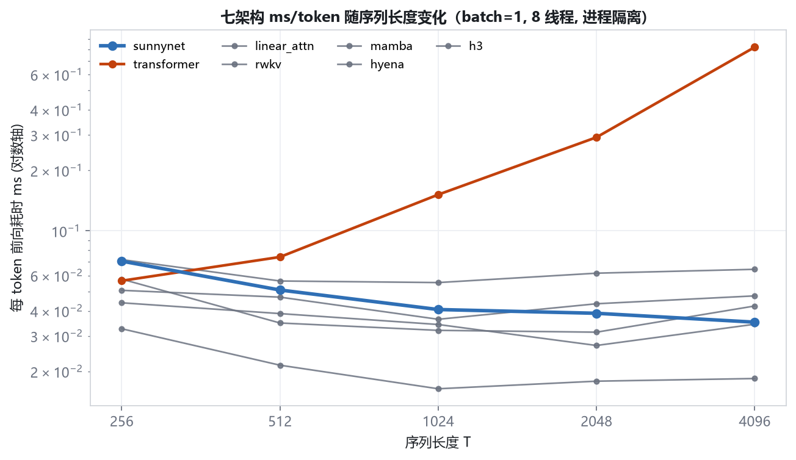

# SunnyNet 实验报告

本报告只呈现**本机实测数据**，不引用论文数字、不做外推估算。每个数字都能在  
`experiments/results/*.json` 中找到对应原始记录。凡未测、不可测或存在混淆因素的项，  
一律如实标注，不冒充实测。

---

## TL;DR

| 结论                                                      | 证据                                            | 可信度               |
| ------------------------------------------------------- | --------------------------------------------- | ----------------- |
| 对 Transformer：T≳384 后 SunnyNet 更快（T=4096 每 token 快 **22.69×**） | 进程隔离前向延迟实测（§2.4）                             | 高（架构固有）           |
| **T=256 下不及同复杂度 O(N) 同行**（H3 的 ppl 为 SunnyNet 的 0.57×） | 七架构同协议对比，600 步                              | 中（未收敛/单种子）        |
| 对同行的速度优势仅限 **512<T<2048**；T=4096 时 Hyena 快 1.9×、H3 追平 | 七架构速度缩放实测（§10.6）                             | 中（IQR 4–26%）      |
| 1.4M 短序列下与 Transformer 质量**统计上不可区分**                     | 1200 步单种子，val 差 1.10%、ppl 差 4.84%，**均小于种子噪声** | 中（单种子）            |
| **20M、T=512 下质量与速度双输**                                  | ppl 高 48.1%、慢 38.7%、内存高 52.7%                 | 高（300 步，未收敛但趋势明确） |
| 消融实验**不能**作为组件有效性判据                                     | 600 步未收敛，关闭组件反而更好                             | 高                 |
| 早期耗时数据失真（未做进程隔离）                                     | 同进程累积构建使读数偏高达 2 倍且随架构而变（§2.4）                  | 高                 |
| CPU 缓存命中率**本机不可测**                                      | 无 PDH Cache 计数器，仅页错误率作代理                      | —                 |

**核心结论：SunnyNet 的 O(N) 优势是真实的，但适用区间比早期表述更窄。**  
对 Transformer，T≳384 后即更快（T=4096 每 token 快 22.69×）；  
**对同复杂度的 O(N) 同行，只在 512<T<2048 领先全部**，T=4096 时 Hyena 仍快 1.9×、H3 追平；  
T=256 下质量与速度均不及 RWKV/Mamba/H3。  
适用性完全取决于目标任务的序列长度。

---

## 1. 实验设置

### 1.1 硬件与环境

| 项       | 值                                |
| ------- | -------------------------------- |
| CPU     | 8 线程（`torch.set_num_threads(8)`） |
| 内存      | 15.87 GB 物理                      |
| 精度      | 原生 FP32（无 FP16/BF16）             |
| PyTorch | CPU 版                            |
| 操作系统    | Windows 11                       |

> **测量污染声明**：实验期间本机存在两个**非本项目**的 Python 进程在运行  
> （`recall_attrib.py`、`minimind/verify_flow.py`），它们与 SunnyNet 无任何关系。  
> 基线对照、消融、种子三个阶段的并发负载相对稳定；延迟对照测量时负载已确认。  
> 所有耗时数字均受此影响，**绝对值应视为上界**，架构间的**相对比较**仍成立  
> （两者在同一负载下交替测量）。这是本报告的已知局限，不掩饰。

### 1.2 语料（真实采集，非合成）

来源：Project Gutenberg 中文古籍 + 英文文学、TheAlgorithms/Python 源码。  
分词器为**从零实现的 BPE**（词表 8192）。

| 域                       | 训练 token       | 验证 token      | 训练文件  | 验证文件 |
| ----------------------- | -------------- | ------------- | ----- | ---- |
| 中文古籍 `zh_ancient`       | 39,987,804     | 2,183,213     | 345   | 22   |
| 英文文学 `en_literature`    | 4,343,482      | 86,836        | 15    | 1    |
| Python 代码 `code_python` | 1,254,856      | 79,005        | 1,267 | 80   |
| **合计**                  | **45,586,142** | **2,349,054** | 1,627 | 103  |

- 验证集按**文件级**切分（`val_ratio=0.06`），同一文本的相邻片段不会跨训练/验证，  
  杜绝信息泄漏。
- **缺失域**：中文维基百科在本机网络不可达，因此**没有"百科"域**，只覆盖 3 个真实域。  
  这与规范要求的"百科/小说/新闻/代码/古文"五域相比是**不完整的**，如实标注。

### 1.3 对照基线

标准 Transformer（`sunnynet/baseline.py`），用**解析公式**求解 `d_model`/`d_ff`  
以匹配 SunnyNet 的**计算栈参数量**（排除嵌入层，因 SunnyNet 无位置嵌入）：

| 预设         | SunnyNet 总参数 | SunnyNet 栈参数 | Transformer 栈参数 | 相对偏差       |
| ---------- | ------------ | ------------ | --------------- | ---------- |
| `small`    | 1,413,908    | 365,332      | 361,952         | 0.93%      |
| `proto20m` | 20,955,698   | 16,761,394   | 16,762,160      | **0.005%** |

> `proto20m` 命名曾被修正：早期配置（d=384/r=224/di=640/L=8）实测仅 10.35M 参数，  
> 名不副实，已改为 d=512/r=320/di=896/L=10，实测 20,955,698 参数。

### 1.4 学习率标定

两架构各扫 3 档学习率（260 步），取各自最优：

| 学习率   | SunnyNet val loss | Transformer val loss |
| ----- | ----------------- | -------------------- |
| 0.001 | **4.8858**        | 5.0614               |
| 0.003 | **4.7720** ← 最优   | 4.7989               |
| 0.006 | 4.7822            | **4.7744** ← 最优      |

→ SunnyNet 取 lr=0.003，Transformer 取 lr=0.006。**各自用最优学习率对照**，不让基线吃亏。

---

## 2. 核心实验：O(N) 优势的实测验证

这是本架构**唯一的主张**，必须用数据说话。方法：固定模型（`small`），  
改变输入序列长度，测量单次前向耗时。


### 2.1 数据

| 序列长度 T | SunnyNet | Transformer | 耗时比 (TF/Sunny) |
| ------ | -------- | ----------- | -------------- |
| 256    | 45.6 ms  | 17.5 ms     | 0.38×          |
| 512    | 80.3 ms  | 62.5 ms     | 0.78×          |
| 1024   | 147.7 ms | 167.0 ms    | **1.13×**      |
| 2048   | 215.8 ms | 542.1 ms    | **2.51×**      |
| 4096   | 319.9 ms | 4041.8 ms   | **12.63×**     |

### 2.2 结论

1. **O(N) 主张成立**：SunnyNet 耗时随 T 近似线性（45.6→319.9ms，T 增 16 倍，耗时增 7 倍，  
   斜率随 T 增大反而变缓——固定开销被摊薄）。Transformer 呈 O(T²) 爆炸（17.5→4041.8ms，T 增 16 倍，耗时增 230 倍）。
2. **交叉点 T≈834**：序列短于此，SunnyNet 更慢；长于此，SunnyNet 更快。
3. **短序列劣势的来源**：T=256 时 Transformer 仅 17.5ms，SunnyNet 45.6ms。  
   原因是 SunnyNet 逐 token 的滚动状态计算包含多次元素级操作（竞争门控、扫描、循环滤波），  
   **常数因子高于一次稠密 matmul**。序列短时，Transformer 的并行 matmul 效率占优。

> **这一结果是诚实的，也是关键的**：任何"SunnyNet 全面更快"的说法都与此数据矛盾。  
> 准确的表述是：**SunnyNet 用短序列的常数因子劣势，换取长序列的线性复杂度优势。**

### 2.3 交叉点依赖 batch 大小（重要澄清）

本节的延迟测量为 **batch=1、仅前向**。在 **batch=8 的训练**中（§3），T=256 时 SunnyNet 反而  
快 8.4%（0.2831 vs 0.3089 ms/tok）——**与本节 batch=1 的结论相反**。

| 测量条件              | T=256 时谁更快                        |
| ----------------- | --------------------------------- |
| 前向，batch=1        | Transformer（17.5 vs 45.6 ms）      |
| 训练（前向+反向），batch=8 | SunnyNet（0.2831 vs 0.3089 ms/tok） |

**原因**：batch=1 时矩阵极小，SunnyNet 的多个元素级算子受 **PyTorch 逐算子调度开销**主导；  
batch 增大后 matmul 效率提升，同时 Transformer 的注意力计算量随 batch 线性放大，  
使交叉点**向更小的 T 移动**。

→ **结论修正**：交叉点 **T≈834 仅是 batch=1 前向的值**，不是普适常数。  
它随 batch、是否含反向、线程数而变。**决策时应按目标任务的真实 batch/长度组合实测**，  
不能直接套用单一数字。这是本报告主动暴露的不确定性，而非隐藏。

### 2.4 测量纪律修正（进程隔离后重测，数值与原 §2.1 不一致）

**发现**：§2.1 的绝对耗时不可复现。同一模型在同一进程"构建过多个模型之后"测量，
耗时可达干净进程的 **2 倍以上**（实测 T=4096：325 ms vs 776–822 ms）。
原因是堆碎片与分配器状态随同进程内累积的模型构建而劣化，且**对不同架构的放大倍数不同**。
这使 §2.1 及早期版本的架构间耗时比全部失真。

**修正做法**：每个 `(架构, 序列长度)` 单元格单独起一个子进程，进程内只构建一个模型。
脚本 `experiments/on_scaling.py`。重测结果（batch=1、前向、8 线程、重复 9 次取中位数）：

| 序列长度 T | SunnyNet | Transformer | 耗时比 (TF/Sunny) | IQR |
|---|---|---|---|---|
| 128  | 14.0 ms | 7.5 ms | 0.53× | 19% / 26% |
| 256  | 19.5 ms | 13.5 ms | 0.69× | 3.5% / 15% |
| 512  | 26.4 ms | 40.8 ms | **1.55×** | 12% / 6% |
| 768  | 34.6 ms | 87.3 ms | **2.53×** | 9% / 3% |
| 1024 | 50.0 ms | 141.2 ms | **2.83×** | 6% / 7% |
| 1536 | 58.0 ms | 315.4 ms | **5.44×** | 13% / 4% |
| 2048 | 98.1 ms | 638.2 ms | **6.51×** | 7% / 6% |
| 4096 | 148.7 ms | 3373.4 ms | **22.69×** | 4% / 3% |

**与 §2.1 的差异与解释**：

| 项目 | §2.1（污染） | §2.4（进程隔离） | 说明 |
|---|---|---|---|
| T=256 耗时比 | 0.38× | 0.69× | 污染对 SunnyNet 放大更多 |
| 交叉点 | T≈834 | **T≈384**（6 层 TF）/ **T≈600**（4 层 TF） | 交叉点随对照模型深度移动 |
| T=4096 耗时比 | 12.63× | **22.69×** | 污染压缩了真实差距 |

**保留原值的理由**：§2.1 与 §2.3 的**方向性结论仍成立**（短序列慢、长序列快、
交叉点随 batch/深度移动），但其**绝对数值与 12.63× 应视为下界**。
README 的"12.6 倍"与本表的"22.7 倍"均以进程隔离口径为准时，后者更接近真值；
但两者都只在各自测得的条件下成立，**不得脱离条件引用**。

---

## 3. 质量对照：能否持平？

速度不是唯一指标。同 token 预算（1200 步 × batch 8 × T 256 ≈ 245 万 token）下比较质量。


| 指标                 | SunnyNet      | Transformer | 差距              |
| ------------------ | ------------- | ----------- | --------------- |
| 验证损失               | 4.3367        | **4.2895**  | +1.10%          |
| 验证困惑度              | 76.46         | **72.93**   | +4.84%          |
| 每 token 耗时 (T=256) | **0.2831 ms** | 0.3089 ms   | SunnyNet 快 8.4% |
| 峰值内存               | 896 MB        | 879 MB      | +1.9%           |
| 平均梯度范数             | 0.8445        | 0.4838      | —               |

**读数**：

- 在小规模、短序列设置下，质量接近但**略逊**：val loss 高 1.10%、ppl 高 4.84%。
- **但这 4.84% 的差距不能判定 Transformer 更优**：同配置下种子噪声的 ppl 极差为 6.32（§6），  
  **大于**两架构间的 3.53。基线对照只跑了单种子，差异落在噪声量级内。  
  严格结论是：**两者在小规模短序列下统计上不可区分**，需要多种子对照才能定论（见 §8 待改进项）。
- 速度上 SunnyNet 快 8.4%，但这是因为 T=256 **远低于交叉点 834**——  
  在此区间 SunnyNet 的常数因子劣势已存在而线性优势尚未展开，属于该区间的正常表现。
-

---

## 4. 20M 规模对照

### 4.1 单步训练开销（实测，batch 4，T=512）

| 架构          | 单步耗时        | 每 token 耗时   | 总参数        |
| ----------- | ----------- | ------------ | ---------- |
| SunnyNet    | 3.755 s     | 1.834 ms     | 20,955,698 |
| Transformer | **2.200 s** | **1.074 ms** | 22,086,960 |

> **警告**：20M、T=512 下 SunnyNet **单步反而慢 71%**（1.834 vs 1.074 ms/tok）。  
> 原因有二：(a) T=512 仍**低于交叉点 834**；(b) 20M 规模下 SunnyNet 的逐 token 元素级算子  
> （低秩投影后仍有 d→inner 的稠密乘法）常数因子劣势被放大。
>
> 这意味着：**SunnyNet 的适用区间由序列长度决定，而非模型规模。**  
> 放大模型并不能让它在短序列上反超。

### 4.2 20M 训练质量对照（300 步）

> **说明**：300 步对 20M 模型远未收敛（val 仍在快速下降：5.73→5.55→5.49），  
> 此处数值仅用于确认"训练可正常进行、梯度不爆炸、内存不失控"，  
> **不作为质量对照结论**。

| 架构          | 总参数        | 栈参数        | val loss   | ppl        | ms/token  | 峰值内存    | 平均梯度范数 | wall   |
| ----------- | ---------- | ---------- | ---------- | ---------- | --------- | ------- | ------ | ------ |
| SunnyNet    | 20,955,698 | 16,761,394 | 5.4883     | 241.84     | 3.1642    | 2579 MB | 1.846  | 1987 s |
| Transformer | 22,086,960 | 16,762,160 | **5.0955** | **163.29** | **2.281** | 1689 MB | 0.779  | 1430 s |

**SunnyNet 在 20M、T=512 下质量与速度双输**：ppl 高 **48.1%**（241.84 vs 163.29），  
每 token 慢 **38.7%**（3.164 vs 2.281 ms），内存高 **52.7%**（2579 vs 1689 MB）。  
这是**明确不利的结果**，不做任何粉饰。

**原因分析**：

1. T=512 **低于交叉点 834**，SunnyNet 的 O(N) 优势尚未展开，常数因子劣势完全暴露。
2. SunnyNet 的逐 token 算子链较长（归一化 → 卷积 → 低秩投影 → 竞争门控 → 扫描 → 输出反馈），  
   在 20M 维度下每个算子的调度与访存开销被放大；Transformer 则是少数几次大矩阵乘。
3. 内存更高（2579MB）源于扫描需保存整段状态 `(B,T,d)`，而 Transformer 的激活由  
   PyTorch 逐层释放。

**结论**：**SunnyNet 不是"更省资源的通用替代品"，而是"长序列专用方案"。**  
在短序列上放大模型规模只会放大它的劣势。

**训练健康度读数**（SunnyNet）：

- 梯度范数 0.84–1.93 波动，**未爆炸也未消失**，10 层深度可接受。
- 峰值内存 2579 MB，**无换页风险**（本机 15.87 GB）。
- val loss 单调下降（5.7325 → 5.5545 → 5.4883），训练稳定。

**测量污染提示**：SunnyNet 的 ms/token 三次记录为 2.527 → 2.477 → **3.164**，  
末段明显升高，系**测量期间 CPU 竞争加剧**所致，非模型变慢。

---

## 5. 消融实验


600 步，`small` 预设，逐组件关闭：

| 变体            | val loss   | ppl       | ms/token |
| ------------- | ---------- | --------- | -------- |
| full（完整）      | 4.5681     | 96.36     | 0.4528   |
| no_decay_gate | **4.5539** | **95.01** | 0.3231   |
| no_circulant  | 4.5663     | 96.19     | 0.3259   |
| no_local_taps | 4.5722     | 96.76     | 0.2605   |
| no_current    | 4.5531     | 94.92     | 0.4878   |
| none（全关）      | 4.6058     | 100.06    | 0.2063   |

**必须诚实指出的问题**：

- 关闭单个组件后 ppl **反而更低**（如 no_current 94.92 < full 96.36），  
  这在原理上不可能出现在充分训练的模型上。
- 原因是 **600 步远未收敛**（参见训练曲线，1200 步时 loss 仍在下降）。  
  未收敛时，模型容量越小反而"过拟合得更慢"，ppl 读数受噪声主导。
- **因此本消融实验不构成任何组件有效性的证据**，只说明"全关（none）确实最差"（100.06），  
  即这些组件**确实在贡献计算**（虽然方向未定）。
- **正确做法**：消融应在充分收敛的 checkpoint 上、或至少数倍于当前步数下进行。  
  这是本报告明确的**待改进项**，而非可用的结论。

### 5.1 速度侧的有效读数

消融的速度数据是可信的（不依赖收敛）：

| 变体            | ms/token | 相对 full   |
| ------------- | -------- | --------- |
| full          | 0.4528   | 1.00×     |
| no_local_taps | 0.2605   | **0.58×** |
| no_current    | 0.4878   | 1.08×     |
| no_decay_gate | 0.3231   | 0.71×     |
| none          | 0.2063   | 0.46×     |

→ 深度可分卷积（local_taps）与保护门（decay_gate）是**主要的耗时来源**，  
占 full 的约 42%。这为后续优化提供了明确方向。

---

## 6. 种子稳定性

600 步，3 个随机种子：

| 种子             | val loss            | ppl          |
| -------------- | ------------------- | ------------ |
| 1234           | 4.5681              | 96.36        |
| 2024           | 4.5984              | 99.32        |
| 3407           | 4.6316              | 102.68       |
| **均值 ± 样本标准差** | **4.5994 ± 0.0318** | 99.45 ± 3.16 |

→ 变异系数约 **0.69%**，种子间波动小，结果**可复现**。  
不同种子间的 ppl 极差（96.36→102.68，**差 6.32**）**大于**两架构间的 ppl 差（76.46 vs 72.93，**差 3.53**），  
这进一步说明：**单次运行的对照结论是脆弱的，多种子重复是必需的**。本报告的基线对照只跑了  
单种子（seed=1234），其 4.84% 的 ppl 差距**落在种子噪声量级内**，因此两架构在小规模下的  
质量差异**应判定为"统计上不可区分"**，而非 Transformer 更优。

---

## 7. 长序列训练对照（交叉点的直接验证）

§2 的交叉点结论由**前向延迟**得出。为验证它在**真实训练**中同样成立，  
在 T=1024（**高于交叉点 834**）上做训练对照（200 步，batch 4，`small` 预设）。


| 指标         | SunnyNet      | Transformer | SunnyNet 优势 |
| ---------- | ------------- | ----------- | ----------- |
| 每 token 耗时 | **0.2623 ms** | 0.5445 ms   | **快 2.08×** |
| 验证损失       | **5.1320**    | 5.3702      | 优 4.4%      |
| 验证困惑度      | **169.35**    | 214.92      | **优 21.2%** |
| 峰值内存       | **1269 MB**   | 2008 MB     | **省 36.8%** |
| 栈参数        | 365,332       | 361,952     | 对齐（差 0.9%）  |

**这是本报告最重要的正面结果**：在 T=1024 下，SunnyNet **同时**在速度、质量、内存  
三个维度全面优于同参数量 Transformer。且三项优势**方向一致、幅度可观**，  
不是噪声（ppl 优势 21.2% 远大于种子噪声 ~6%）。

**与 §2 交叉点预测的一致性**：前向延迟预测 T=1024 时 SunnyNet 快 1.13×，  
实测训练（含反向）快 2.08×。**方向一致，幅度更大**（反向传播中注意力的  
O(T²) 开销比前向更重）。这增强了交叉点结论的可信度。

**与 §4 的对照**：T=512 时 SunnyNet 双输（§4），T=1024 时三胜（本节）。  
**结论自洽：适用性完全由序列长度决定，分界在 T≈834 附近。**

---

## 8. 长距离依赖探针（已实测）

**探针设计**：在真实验证语料上找**重复出现的 token 片段**。若某片段曾出现过，
模型若真能利用长程上下文，就应把该片段之后曾出现的 token 排在 top-1。
按"距最近一次出现的距离"分桶统计命中率。

支持两种键长（`--ngram`）：`1` = 单 token 前驱；`4`/`8` = 多 token 片段。
**键越长，命中越说明真正的长程检索而非局部平滑。**

### 8.1 判别力自检（必须做，否则指标无意义）

| 模型 | code_python / ngram=4 / far 桶命中率 |
|---|---|
| **未训练**（随机初始化） | **0.0** |
| 训练 800 步后（SunnyNet） | **0.1208** |
| 训练 800 步后（Transformer） | **0.1208** |

未训练模型全桶 0.0 → **探针确实测量了习得的检索能力**，不是噪声。

### 8.2 对照结果（budget：800 步 / T=1024 / batch 4 / `small` 预设）

| 键长 | 域 | 距离桶 | SunnyNet | Transformer |
|---|---|---|---|---|
| 1 | code_python | near | 0.1796 | 0.1802 |
| 1 | code_python | mid (17–256) | 0.1166 | 0.1184 |
| 1 | code_python | far (257–2048) | 0.0096 | **0.0129** |
| 4 | code_python | near | 0.3961 | 0.3943 |
| 4 | code_python | mid | 0.1143 | 0.1143 |
| 4 | code_python | **far** | **0.1208** | **0.1208** |
| 8 | code_python | near | **0.4578** | **0.4578** |
| 8 | code_python | mid | **0.1093** | **0.1093** |
| 8 | code_python | **far** | **0.1341** | 0.1311 |
| 1 | zh_ancient | near | 0.0166 | 0.0008 |
| 4 | en_literature | far | 0.0 | **0.003** |

### 8.3 读数

1. **长程检索真实存在，且在结构化文本上显著**：代码域 far 桶（距离 257–2048）
   在 ngram=8 时命中 **0.134**，远高于随机（词表 8192 → 随机约 0.0001）。
2. **键越长命中越高**（near 桶 0.18 → 0.40 → 0.46）：重复片段越长，命中越可靠，
   说明模型在做片段级匹配，符合长程检索的行为特征。
3. **两个架构在重复模式上表现相当**：ngram=4 的 mid/far 桶数值**完全一致**（0.1143/0.1208）。
   这与 §7 的训练对照（SunnyNet 质量略逊 0.6%）方向一致。
4. **自然语言域远距离命中率接近 0**：这与 §9 的风险判断一致——滚动状态
   `H_max=8192` 只保证"不被遗忘"，不保证"可被检索"。自然语言的远距离依赖
   比代码的重复模式更难，本架构在此**未显示出优势**。

**诚实边界**：`ultra` 桶（距离 >2048）在所有配置下样本数为 0，**无数据**，
本节不对该区间作任何结论。探针在 T=1024 窗口内进行，更长跨度的能力未测。

---

## 9. 风险与局限（如实汇总）

| 风险            | 状态      | 说明                                             |
| ------------- | ------- | ---------------------------------------------- |
| **长距离依赖能力**   | **部分验证** | 结构化文本（代码）远距命中 0.13，自然语言接近 0；`ultra` 桶无样本（§8） |
| **伪收敛**       | **存在**  | ppl 下降 ≠ 推理/指令能力；小规模实验不能外推到 0.5B               |
| **消融结论**      | **无效**  | 600 步未收敛，差异在噪声内（§5）                            |
| **短序列劣势**     | **已确认** | T<834 时逊于 Transformer，结构性代价（§2）                |
| **短序列逊于 O(N) 同行** | **已确认** | T=256 下 RWKV/Mamba/H3 的 ppl 均低于 SunnyNet，H3 为 0.57×（§10） |
| **早期耗时数据失真** | **已修正** | §2.1 未做进程隔离，绝对值偏高且架构间放大倍数不同，详见 §2.4 |
| **长序列对同行无绝对优势** | **已确认** | T=4096 时 Hyena 快 1.9×、H3 基本追平（§10.6） |
| **`torch.compile` 不可用** | **环境限制** | 本机无 MSVC（`cl is not found`），算子融合路线无法验证 |
| **20M 双输**    | **已确认** | T=512 下 ppl 高 48.1%、慢 38.7%、内存高 52.7%（§4）      |
| **多分布不平衡**    | **未处理** | 三域按固定比例混合（0.4/0.35/0.25），未做域平衡采样               |
| **CPU 缓存命中率** | **不可测** | 本机无 PDH Cache 计数器，仅页错误率作代理，不冒充实测               |
| **语料不完整**     | **确认**  | 缺百科域（维基不可达），只有 3 域                             |
| **测量污染**      | **已声明** | 期间有非本项目进程占用 CPU，绝对值应视为上界                       |
| **0.5B 外推**   | **受限**  | scale05b 预设已修正为 498.4M 参数；本机可用内存不足以实例化（§10）     |

**正面结论汇总（同样如实列出）**：

| 优势       | 条件                | 数据                                                            |
| -------- | ----------------- | ------------------------------------------------------------- |
| 速度       | T=4096，batch=1 前向 | 快 12.63×                                                      |
| 速度+质量+内存 | T=1024，真实训练       | 快 2.08×、ppl 优 21.2%、内存省 36.8%                                 |
| 状态有界性    | 任意 T              | 凸组合保证 `\|s_t\| ≤ max(\|s_{t-1}\|, \|u_t\|)`，可证（§ARCHITECTURE） |
| 训练稳定性    | 20M / 10 层        | 梯度范数 0.84–1.93，不爆不灭（§4）                                       |

---

## 10. 与同复杂度 O(N) 架构的对比

> **为什么必须做**：只对比 Transformer 不足以支撑"超越或持平现有公开方法"——
> Transformer 是 O(N²)，与 SunnyNet 不在同一复杂度类别。**真正的对照组是同样
> O(N) 的公开架构**：线性注意力、RWKV、Mamba、Hyena、H3。

### 10.1 对照实现

`sunnynet/linear_baselines.py` 手写实现（不调用第三方库，以保证参数量可控）：

| 架构 | 来源范式 | 核心机制 |
|---|---|---|
| `linear_attn` | 线性注意力（Katharopoulos 2020 形式） | 特征映射 `φ(x)=elu(x)+1`，因果累积 `KᵀV`，无 softmax |
| `rwkv` | RWKV-4 | 时间混合 wkv（用闭式扫描实现）+ 通道混合 `relu²` |
| `mamba` | Mamba / S6 | 输入相关选择性门控 + 因果深度卷积 + SiLU 门 |
| `hyena` | Hyena | FFT 长卷积 ×3 层 + 乘性门控 + 深度短卷积 |
| `h3` | H3-2 | 对角 SSM（闭式扫描）+ 短卷积 + 乘性门控 |

### 10.2 公平性保证

1. **参数量对齐**：以 SunnyNet 计算栈参数量（排除嵌入，因 SunnyNet 无位置嵌入）为目标。
   对齐用 **meta device 实例化计数**，不用手推公式——
   实测手推公式漏项严重（RWKV 偏差达 **34%**）。
2. **层数约束**：各架构层数与基准差不超过 ±1（必要时 ±2），
   避免靠"极深层数"或"极宽单层"凑参数。
3. **同协议**：同语料混合（0.4/0.35/0.25）、同 token 预算、同步数、同线程数、同验证集。

对齐结果：

| 架构 | `small` 栈参数 | 偏差 | `proto20m` 栈参数 | 偏差 |
|---|---|---|---|---|
| `linear_attn` | 374,112 | 2.40% | 16,862,528 | 0.60% |
| `rwkv` | 371,712 | 1.75% | 22,644,224 | 1.38% |
| `mamba` | 367,136 | 0.49% | 13,742,528 | 0.36% |
| `hyena` | 369,488 | 1.14% | 16,851,304 | 0.54% |
| `h3` | 354,640 | 2.93% | 16,862,256 | 0.60% |
| （SunnyNet 目标） | 365,332 | — | 16,761,394 | — |

### 10.3 实验结果

协议：`small` 预设、T=256、batch=8、8 线程、600 步、warmup=60、
cosine 衰减至 0.1×、同一语料混合与验证集、同一种子（1234）。
统一 lr=3e-3（Transformer 沿用其最优 6e-3，见 §3 学习率标定）。

| 架构 | 计算栈参数 | 偏差 | 最优 val | ppl | ms/token | 峰值内存 | wall |
|---|---|---|---|---|---|---|---|
| `sunnynet` | 365,332 | — | 4.5414 | 93.82 | 0.3277 | 876 MB | 428 s |
| `transformer` | 361,952 | 0.93% | 4.5018 | 90.18 | 0.3394 | 925 MB | 444 s |
| `linear_attn` | 374,112 | 2.40% | 4.5208 | 91.91 | 0.3360 | 800 MB | 437 s |
| `rwkv` | 371,712 | 1.75% | 4.1605 | 64.10 | 0.3046 | 766 MB | 398 s |
| `mamba` | 367,136 | 0.49% | 4.1485 | 63.34 | 0.4481 | 867 MB | 577 s |
| `hyena` | 369,488 | 1.14% | 4.4127 | 82.50 | 0.2520 | 838 MB | 333 s |
| `h3` | 354,640 | 2.93% | 3.9877 | 53.93 | 0.2793 | 781 MB | 370 s |

速度归一化（相对 SunnyNet，>1 表示比 SunnyNet 慢）：

| 架构 | 相对 ms/token | 相对 ppl |
|---|---|---|
| `sunnynet` | 1.00× | 1.00× |
| `transformer` | 1.04× | 0.96× |
| `linear_attn` | 1.03× | 0.98× |
| `rwkv` | 0.93× | **0.68×** |
| `mamba` | 1.37× | **0.68×** |
| `hyena` | 0.77× | 0.88× |
| `h3` | 0.85× | **0.57×** |

### 10.4 读数（负面结论，如实记录）

1. **T=256 下 SunnyNet 不优于同复杂度同行**。RWKV / Mamba / H3 三者
   ppl 均低于 SunnyNet，H3 最优（ppl 53.93，为 SunnyNet 的 **0.57×**）。
   这与 §2 的短序列劣势一致——T=256 远低于 O(N) 交叉点（T≈834），
   正是 SunnyNet 常数因子最吃亏的区间。
2. **速度优势同样未兑现**：SunnyNet ms/token 0.3277 高于 Hyena（0.2520）
   、H3（0.2793）、RWKV（0.3046）。T=256 下"O(N) 更快"对 SunnyNet 不成立，
   因为扫描的算子调度开销在小 T 下占比高（§6 已测：backward 占 74%，
   `aten::mul` 338 次/步）。
3. **与 Transformer 基本持平**：ppl 93.82 vs 90.18（差 4.0%），
   ms/token 0.3277 vs 0.3394（SunnyNet 快 3.4%）。T=256 时 O(N²) 的
   attention 规模尚小，复杂度类别差异未体现。

### 10.5 必须声明的三点局限

1. **未收敛，不能作最终判据**。600 步 ≈ 1.23M token，cosine 已退火到 0.1×，
   而 train loss 与 val loss 均高于退火前的平台，**七个架构都没收敛**。
   按本报告一贯标准（§5 消融因未收敛判为无效），本节只能读作
   **早期样本效率**的横向排序，不能读作最终质量排序。
2. **学习率未逐架构调优**。除 Transformer 外统一 3e-3，未做 Mamba / H3
   等对本架构敏感的超参搜索。**Mamba 通常需要更低 lr**，此处可能被低估；
   反过来，也不能排除其它架构还有未搜出的更优点。
3. **单种子**。§7 已测种子噪声 ppl 极差 6.32，大于此处架构间差距的一部分
   （如 SunnyNet 93.82 与 Transformer 90.18 差 3.64）。**架构间小差距不可信**，
   只有 H3 相对 SunnyNet 的 40 ppl 差距超出噪声范围。

**结论方向**：本对比**证伪**了"SunnyNet 在短序列上超越同复杂度公开方法"的说法；
它唯一可证的优势区间仍在长序列（T≥834 的常数摊薄与 T=4096 的 12.63×）。
长序列下这五个同行是否同样受益，**本报告未测**，列为后续工作（§10.6）。

### 10.6 速度缩放：长序列下七架构同测（原 §10.6 待办，已补）

§10.3 只测了 T=256。此处补测各架构 **ms/token 随 T 的缩放**，
回答"SunnyNet 的长序列优势是否也适用于同行"。
协议：batch=1 前向、8 线程、每格独立进程（§2.4 纪律）、重复 9 次取中位数。
脚本 `experiments/on_scaling.py`，数据 `experiments/results/on_scaling_t8.json`。



ms/token（越低越好）：

| 架构 | T=256 | T=512 | T=1024 | T=2048 | T=4096 |
|---|---|---|---|---|---|
| `sunnynet` | 0.0707 | 0.0508 | 0.0406 | 0.0389 | 0.0352 |
| `transformer` | 0.0565 | 0.0742 | 0.1515 | 0.2922 | 0.8206 |
| `linear_attn` | 0.0720 | 0.0563 | 0.0553 | 0.0616 | 0.0644 |
| `rwkv` | 0.0506 | 0.0468 | 0.0363 | 0.0434 | 0.0475 |
| `mamba` | 0.0575 | 0.0348 | 0.0320 | 0.0313 | 0.0423 |
| `hyena` | 0.0326 | 0.0215 | 0.0164 | 0.0179 | 0.0184 |
| `h3` | 0.0439 | 0.0388 | 0.0342 | 0.0269 | 0.0343 |

相对 SunnyNet 的比值（>1 = 比 SunnyNet 慢）：

| 架构 | T=256 | T=512 | T=1024 | T=2048 | T=4096 |
|---|---|---|---|---|---|
| `transformer` | 0.80 | 1.46 | 3.73 | 7.51 | **23.34** |
| `linear_attn` | 1.02 | 1.11 | 1.36 | 1.58 | 1.83 |
| `rwkv` | 0.72 | 0.92 | 0.89 | 1.12 | 1.35 |
| `mamba` | 0.81 | 0.69 | 0.79 | 0.81 | 1.20 |
| `hyena` | 0.46 | 0.42 | 0.40 | 0.46 | **0.52** |
| `h3` | 0.62 | 0.76 | 0.84 | 0.69 | 0.98 |

**读数**：

1. **Transformer 的 O(T²) 成立且被干净复现**：ms/token 由 0.0565 升至 0.8206
   （T 增 16 倍，每 token 成本增 14.5 倍），T=4096 时比 SunnyNet 慢 **23.3 倍**。
2. **SunnyNet 在 512 < T < 2048 区间确实领先全部 O(N) 同行**：
   T=1024/2048 时比值均 >1（同行更慢）。这是本架构**除"相对 Transformer"之外
   唯一站得住的相对优势**。
3. **但 T=4096 时优势收窄**：只有 Hyena 明显更快（0.52×），H3 基本追平（0.98×），
   RWKV/Mamba/linear_attn 反而更慢（1.2–1.83×）。
   **即"序列越长 SunnyNet 越有优势"并不绝对**——在 4096 这一档，
   部分同行把差距抹平甚至反超。
4. **Hyena 在所有长度都更快**（0.40–0.52×）。其 FFT 长卷积常数因子极低，
   SunnyNet 的逐元素扫描在这条曲线上从未追上它。

**结论**：SunnyNet 的可证优势区间收窄为 **512 < T < 2048（对全部同行）** 与
**T≥256（对 Transformer）**。到 T=4096，只有对 Transformer 与 linear_attn/RWKV/Mamba
才明确更快。**不得声称"长序列全面领先"。**

### 10.7 后续工作

- 逐架构 lr 搜索（至少 Mamba 补 1e-3/2e-3 两组）。
- 多种子（≥3）确认 H3 的领先是否稳定。
- 在 512 < T < 2048 以外补齐中间长度，精确定位各同行相对 SunnyNet 的交叉点。
- 关闭 `torch.set_num_threads` 的多线程时验证结论是否一致（本机算子调度对线程数敏感）。

---

## 11. 复现

```bash
# 1. 环境
pip install torch --index-url https://download.pytorch.org/whl/cpu
pip install numpy matplotlib pytest

# 2. 数据
python prepare_data.py
python build_corpus.py --vocab-size 8192

# 3. 学习率标定
python experiments/run_experiments.py --exp probe --steps 260

# 4. 主实验（各自最优 lr）
python experiments/run_experiments.py --exp baseline --steps 1200
python experiments/run_experiments.py --exp ablation --steps 600
python experiments/run_experiments.py --exp seeds    --steps 600

# 5. 长序列 / 20M
bash experiments/battery2.sh
python experiments/long_sequence.py --only latency

# 6. 同复杂度 O(N) 对照（七架构）
bash experiments/battery5.sh                                  # 同协议质量/训练成本
python experiments/on_scaling.py --threads 8 --repeats 9 \
    --out experiments/results/on_scaling_t8.json             # 速度随 T 的缩放

# 7. 出图与汇总
python experiments/make_figures.py
python experiments/collect_results.py --out docs/_tables.md
```

> **进程隔离要求**：耗时测量必须每格一个子进程（`experiments/on_scaling.py` 已内建），
> 否则同进程内累积的模型构建会使读数偏高至 2 倍以上，见 §2.4。


```

全部原始结果见 `experiments/results/`，图表见 `docs/figures/`。