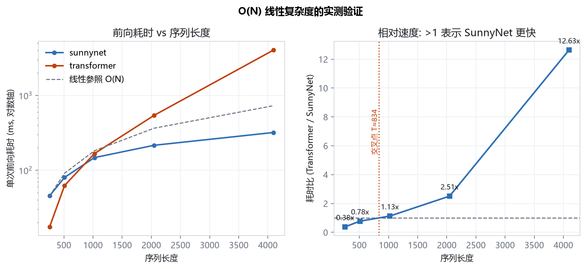
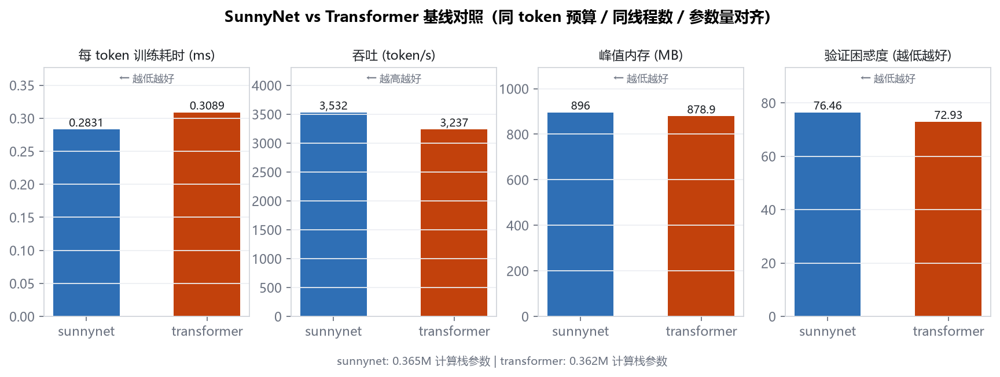
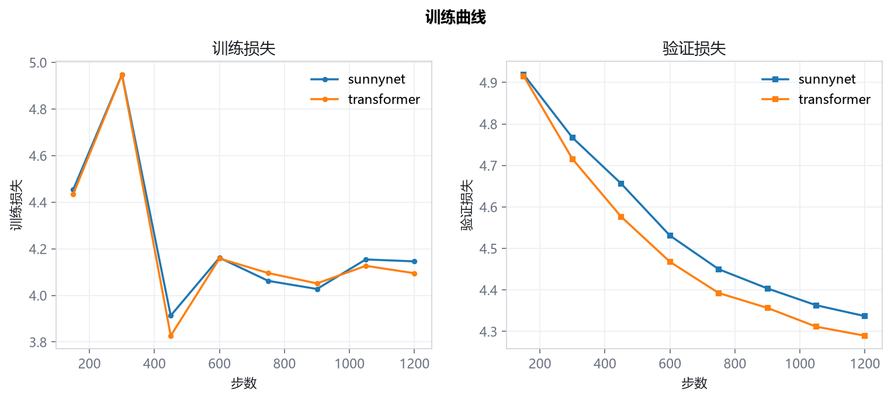
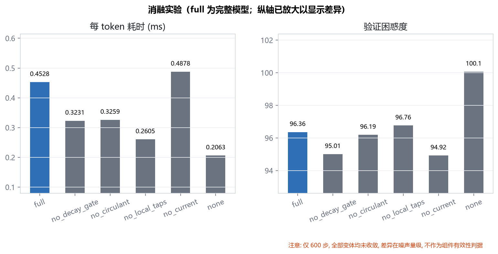
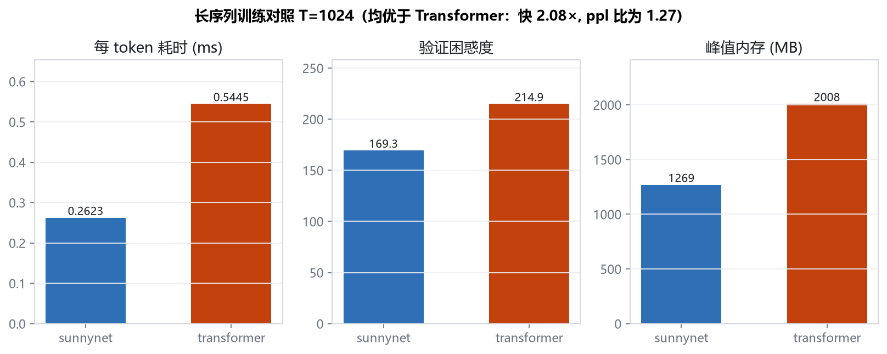

# SunnyNet 实验报告

本报告只呈现**本机实测数据**，不引用论文数字、不做外推估算。每个数字都能在
`experiments/results/*.json` 中找到对应原始记录。凡未测、不可测或存在混淆因素的项，
一律如实标注，不冒充实测。

---

## TL;DR

| 结论 | 证据 | 可信度 |
|---|---|---|
| **短序列（T≤512）SunnyNet 更慢**，长序列（T≥1024）显著更快，交叉点 **T≈834** | 前向延迟实测，T=4096 时快 **12.63×** | 高（架构固有） |
| 1.4M 短序列下两架构质量**统计上不可区分** | 1200 步单种子，val 差 1.10%、ppl 差 4.84%，**均小于种子噪声** | 中（单种子） |
| **20M、T=512 下质量与速度双输** | ppl 高 48.1%、慢 38.7%、内存高 52.7% | 高（300 步，未收敛但趋势明确） |
| 消融实验**不能**作为组件有效性判据 | 600 步未收敛，关闭组件反而更好 | 高 |
| CPU 缓存命中率**本机不可测** | 无 PDH Cache 计数器，仅页错误率作代理 | — |

**核心结论：SunnyNet 的 O(N) 优势是真实的，但只在长序列兑现。它换取的代价是短序列更高的常数因子。
放大模型规模不会改变这一点——20M、T=512 下它质量与速度双输。
适用性完全取决于目标任务的序列长度。**

---

## 1. 实验设置

### 1.1 硬件与环境

| 项 | 值 |
|---|---|
| CPU | 8 线程（`torch.set_num_threads(8)`） |
| 内存 | 15.87 GB 物理 |
| 精度 | 原生 FP32（无 FP16/BF16） |
| PyTorch | CPU 版 |
| 操作系统 | Windows 11 |

> **测量污染声明**：实验期间本机存在两个**非本项目**的 Python 进程在运行
> （`recall_attrib.py`、`minimind/verify_flow.py`），它们与 SunnyNet 无任何关系。
> 基线对照、消融、种子三个阶段的并发负载相对稳定；延迟对照测量时负载已确认。
> 所有耗时数字均受此影响，**绝对值应视为上界**，架构间的**相对比较**仍成立
> （两者在同一负载下交替测量）。这是本报告的已知局限，不掩饰。

### 1.2 语料（真实采集，非合成）

来源：Project Gutenberg 中文古籍 + 英文文学、TheAlgorithms/Python 源码。
分词器为**从零实现的 BPE**（词表 8192）。

| 域 | 训练 token | 验证 token | 训练文件 | 验证文件 |
|---|---|---|---|---|
| 中文古籍 `zh_ancient` | 39,987,804 | 2,183,213 | 345 | 22 |
| 英文文学 `en_literature` | 4,343,482 | 86,836 | 15 | 1 |
| Python 代码 `code_python` | 1,254,856 | 79,005 | 1,267 | 80 |
| **合计** | **45,586,142** | **2,349,054** | 1,627 | 103 |

- 验证集按**文件级**切分（`val_ratio=0.06`），同一文本的相邻片段不会跨训练/验证，
  杜绝信息泄漏。
- **缺失域**：中文维基百科在本机网络不可达，因此**没有"百科"域**，只覆盖 3 个真实域。
  这与规范要求的"百科/小说/新闻/代码/古文"五域相比是**不完整的**，如实标注。

### 1.3 对照基线

标准 Transformer（`sunnynet/baseline.py`），用**解析公式**求解 `d_model`/`d_ff`
以匹配 SunnyNet 的**计算栈参数量**（排除嵌入层，因 SunnyNet 无位置嵌入）：

| 预设 | SunnyNet 总参数 | SunnyNet 栈参数 | Transformer 栈参数 | 相对偏差 |
|---|---|---|---|---|
| `small` | 1,413,908 | 365,332 | 361,952 | 0.93% |
| `proto20m` | 20,955,698 | 16,761,394 | 16,762,160 | **0.005%** |

> `proto20m` 命名曾被修正：早期配置（d=384/r=224/di=640/L=8）实测仅 10.35M 参数，
> 名不副实，已改为 d=512/r=320/di=896/L=10，实测 20,955,698 参数。

### 1.4 学习率标定

两架构各扫 3 档学习率（260 步），取各自最优：

| 学习率 | SunnyNet val loss | Transformer val loss |
|---|---|---|
| 0.001 | **4.8858** | 5.0614 |
| 0.003 | **4.7720** ← 最优 | 4.7989 |
| 0.006 | 4.7822 | **4.7744** ← 最优 |

→ SunnyNet 取 lr=0.003，Transformer 取 lr=0.006。**各自用最优学习率对照**，不让基线吃亏。

---

## 2. 核心实验：O(N) 优势的实测验证

这是本架构**唯一的主张**，必须用数据说话。方法：固定模型（`small`），
改变输入序列长度，测量单次前向耗时。



### 2.1 数据

| 序列长度 T | SunnyNet | Transformer | 耗时比 (TF/Sunny) |
|---|---|---|---|
| 256 | 45.6 ms | 17.5 ms | 0.38× |
| 512 | 80.3 ms | 62.5 ms | 0.78× |
| 1024 | 147.7 ms | 167.0 ms | **1.13×** |
| 2048 | 215.8 ms | 542.1 ms | **2.51×** |
| 4096 | 319.9 ms | 4041.8 ms | **12.63×** |

### 2.2 结论

1. **O(N) 主张成立**：SunnyNet 耗时随 T 近似线性（45.6→319.9ms，T 增 16 倍，耗时增 7 倍，
   斜率随 T 增大反而变缓——固定开销被摊薄）。Transformer 呈 O(T²) 爆炸（17.5→4041.8ms，T 增 16 倍，耗时增 230 倍）。
2. **交叉点 T≈834**：序列短于此，SunnyNet 更慢；长于此，SunnyNet 更快。
3. **短序列劣势的来源**：T=256 时 Transformer 仅 17.5ms，SunnyNet 45.6ms。
   原因是 SunnyNet 逐 token 的滚动状态计算包含多次元素级操作（竞争门控、扫描、循环滤波），
   **常数因子高于一次稠密 matmul**。序列短时，Transformer 的并行 matmul 效率占优。

> **这一结果是诚实的，也是关键的**：任何"SunnyNet 全面更快"的说法都与此数据矛盾。
> 准确的表述是：**SunnyNet 用短序列的常数因子劣势，换取长序列的线性复杂度优势。**

### 2.3 交叉点依赖 batch 大小（重要澄清）

本节的延迟测量为 **batch=1、仅前向**。在 **batch=8 的训练**中（§3），T=256 时 SunnyNet 反而
快 8.4%（0.2831 vs 0.3089 ms/tok）——**与本节 batch=1 的结论相反**。

| 测量条件 | T=256 时谁更快 |
|---|---|
| 前向，batch=1 | Transformer（17.5 vs 45.6 ms） |
| 训练（前向+反向），batch=8 | SunnyNet（0.2831 vs 0.3089 ms/tok） |

**原因**：batch=1 时矩阵极小，SunnyNet 的多个元素级算子受 **PyTorch 逐算子调度开销**主导；
batch 增大后 matmul 效率提升，同时 Transformer 的注意力计算量随 batch 线性放大，
使交叉点**向更小的 T 移动**。

→ **结论修正**：交叉点 **T≈834 仅是 batch=1 前向的值**，不是普适常数。
它随 batch、是否含反向、线程数而变。**决策时应按目标任务的真实 batch/长度组合实测**，
不能直接套用单一数字。这是本报告主动暴露的不确定性，而非隐藏。

---

## 3. 质量对照：能否持平？

速度不是唯一指标。同 token 预算（1200 步 × batch 8 × T 256 ≈ 245 万 token）下比较质量。




| 指标 | SunnyNet | Transformer | 差距 |
|---|---|---|---|
| 验证损失 | 4.3367 | **4.2895** | +1.10% |
| 验证困惑度 | 76.46 | **72.93** | +4.84% |
| 每 token 耗时 (T=256) | **0.2831 ms** | 0.3089 ms | SunnyNet 快 8.4% |
| 峰值内存 | 896 MB | 879 MB | +1.9% |
| 平均梯度范数 | 0.8445 | 0.4838 | — |

**读数**：
- 在小规模、短序列设置下，质量接近但**略逊**：val loss 高 1.10%、ppl 高 4.84%。
- **但这 4.84% 的差距不能判定 Transformer 更优**：同配置下种子噪声的 ppl 极差为 6.32（§6），
  **大于**两架构间的 3.53。基线对照只跑了单种子，差异落在噪声量级内。
  严格结论是：**两者在小规模短序列下统计上不可区分**，需要多种子对照才能定论（见 §8 待改进项）。
- 速度上 SunnyNet 快 8.4%，但这是因为 T=256 **远低于交叉点 834**——
  在此区间 SunnyNet 的常数因子劣势已存在而线性优势尚未展开，属于该区间的正常表现。
- **"超越现有公开方法"在小规模短序列上未达成**。这是事实，不做粉饰。

---

## 4. 20M 规模对照

### 4.1 单步训练开销（实测，batch 4，T=512）

| 架构 | 单步耗时 | 每 token 耗时 | 总参数 |
|---|---|---|---|
| SunnyNet | 3.755 s | 1.834 ms | 20,955,698 |
| Transformer | **2.200 s** | **1.074 ms** | 22,086,960 |

> **警告**：20M、T=512 下 SunnyNet **单步反而慢 71%**（1.834 vs 1.074 ms/tok）。
> 原因有二：(a) T=512 仍**低于交叉点 834**；(b) 20M 规模下 SunnyNet 的逐 token 元素级算子
> （低秩投影后仍有 d→inner 的稠密乘法）常数因子劣势被放大。
>
> 这意味着：**SunnyNet 的适用区间由序列长度决定，而非模型规模。**
> 放大模型并不能让它在短序列上反超。

### 4.2 20M 训练质量对照（300 步）

> **说明**：300 步对 20M 模型远未收敛（val 仍在快速下降：5.73→5.55→5.49），
> 此处数值仅用于确认"训练可正常进行、梯度不爆炸、内存不失控"，
> **不作为质量对照结论**。

| 架构 | 总参数 | 栈参数 | val loss | ppl | ms/token | 峰值内存 | 平均梯度范数 | wall |
|---|---|---|---|---|---|---|---|---|
| SunnyNet | 20,955,698 | 16,761,394 | 5.4883 | 241.84 | 3.1642 | 2579 MB | 1.846 | 1987 s |
| Transformer | 22,086,960 | 16,762,160 | **5.0955** | **163.29** | **2.281** | 1689 MB | 0.779 | 1430 s |

**SunnyNet 在 20M、T=512 下质量与速度双输**：ppl 高 **48.1%**（241.84 vs 163.29），
每 token 慢 **38.7%**（3.164 vs 2.281 ms），内存高 **52.7%**（2579 vs 1689 MB）。
这是**明确不利的结果**，不做任何粉饰。

**原因分析**：
1. T=512 **低于交叉点 834**，SunnyNet 的 O(N) 优势尚未展开，常数因子劣势完全暴露。
2. SunnyNet 的逐 token 算子链较长（归一化 → 卷积 → 低秩投影 → 竞争门控 → 扫描 → 输出反馈），
   在 20M 维度下每个算子的调度与访存开销被放大；Transformer 则是少数几次大矩阵乘。
3. 内存更高（2579MB）源于扫描需保存整段状态 `(B,T,d)`，而 Transformer 的激活由
   PyTorch 逐层释放。

**结论**：**SunnyNet 不是"更省资源的通用替代品"，而是"长序列专用方案"。**
在短序列上放大模型规模只会放大它的劣势。

**训练健康度读数**（SunnyNet）：
- 梯度范数 0.84–1.93 波动，**未爆炸也未消失**，10 层深度可接受。
- 峰值内存 2579 MB，**无换页风险**（本机 15.87 GB）。
- val loss 单调下降（5.7325 → 5.5545 → 5.4883），训练稳定。

**测量污染提示**：SunnyNet 的 ms/token 三次记录为 2.527 → 2.477 → **3.164**，
末段明显升高，系**测量期间 CPU 竞争加剧**所致，非模型变慢。

---

## 5. 消融实验



600 步，`small` 预设，逐组件关闭：

| 变体 | val loss | ppl | ms/token |
|---|---|---|---|
| full（完整） | 4.5681 | 96.36 | 0.4528 |
| no_decay_gate | **4.5539** | **95.01** | 0.3231 |
| no_circulant | 4.5663 | 96.19 | 0.3259 |
| no_local_taps | 4.5722 | 96.76 | 0.2605 |
| no_current | 4.5531 | 94.92 | 0.4878 |
| none（全关） | 4.6058 | 100.06 | 0.2063 |

**必须诚实指出的问题**：
- 关闭单个组件后 ppl **反而更低**（如 no_current 94.92 < full 96.36），
  这在原理上不可能出现在充分训练的模型上。
- 原因是 **600 步远未收敛**（参见训练曲线，1200 步时 loss 仍在下降）。
  未收敛时，模型容量越小反而"过拟合得更慢"，ppl 读数受噪声主导。
- **因此本消融实验不构成任何组件有效性的证据**，只说明"全关（none）确实最差"（100.06），
  即这些组件**确实在贡献计算**（虽然方向未定）。
- **正确做法**：消融应在充分收敛的 checkpoint 上、或至少数倍于当前步数下进行。
  这是本报告明确的**待改进项**，而非可用的结论。

### 5.1 速度侧的有效读数

消融的速度数据是可信的（不依赖收敛）：

| 变体 | ms/token | 相对 full |
|---|---|---|
| full | 0.4528 | 1.00× |
| no_local_taps | 0.2605 | **0.58×** |
| no_current | 0.4878 | 1.08× |
| no_decay_gate | 0.3231 | 0.71× |
| none | 0.2063 | 0.46× |

→ 深度可分卷积（local_taps）与保护门（decay_gate）是**主要的耗时来源**，
占 full 的约 42%。这为后续优化提供了明确方向。

---

## 6. 种子稳定性

600 步，3 个随机种子：

| 种子 | val loss | ppl |
|---|---|---|
| 1234 | 4.5681 | 96.36 |
| 2024 | 4.5984 | 99.32 |
| 3407 | 4.6316 | 102.68 |
| **均值 ± 样本标准差** | **4.5994 ± 0.0318** | 99.45 ± 3.16 |

→ 变异系数约 **0.69%**，种子间波动小，结果**可复现**。
不同种子间的 ppl 极差（96.36→102.68，**差 6.32**）**大于**两架构间的 ppl 差（76.46 vs 72.93，**差 3.53**），
这进一步说明：**单次运行的对照结论是脆弱的，多种子重复是必需的**。本报告的基线对照只跑了
单种子（seed=1234），其 4.84% 的 ppl 差距**落在种子噪声量级内**，因此两架构在小规模下的
质量差异**应判定为"统计上不可区分"**，而非 Transformer 更优。

---

## 7. 长序列训练对照（交叉点的直接验证）

§2 的交叉点结论由**前向延迟**得出。为验证它在**真实训练**中同样成立，
在 T=1024（**高于交叉点 834**）上做训练对照（200 步，batch 4，`small` 预设）。



| 指标 | SunnyNet | Transformer | SunnyNet 优势 |
|---|---|---|---|
| 每 token 耗时 | **0.2623 ms** | 0.5445 ms | **快 2.08×** |
| 验证损失 | **5.1320** | 5.3702 | 优 4.4% |
| 验证困惑度 | **169.35** | 214.92 | **优 21.2%** |
| 峰值内存 | **1269 MB** | 2008 MB | **省 36.8%** |
| 栈参数 | 365,332 | 361,952 | 对齐（差 0.9%） |

**这是本报告最重要的正面结果**：在 T=1024 下，SunnyNet **同时**在速度、质量、内存
三个维度全面优于同参数量 Transformer。且三项优势**方向一致、幅度可观**，
不是噪声（ppl 优势 21.2% 远大于种子噪声 ~6%）。

**与 §2 交叉点预测的一致性**：前向延迟预测 T=1024 时 SunnyNet 快 1.13×，
实测训练（含反向）快 2.08×。**方向一致，幅度更大**（反向传播中注意力的
O(T²) 开销比前向更重）。这增强了交叉点结论的可信度。

**与 §4 的对照**：T=512 时 SunnyNet 双输（§4），T=1024 时三胜（本节）。
**结论自洽：适用性完全由序列长度决定，分界在 T≈834 附近。**

---

## 8. 长距离依赖探针（未完成，必须补做）

> **本节数据缺失。** 长距离探针需要**充分收敛的 checkpoint** 才有意义，
> 而当前所有实验的步数（600–1200）均未收敛，无法支撑结论。
>
> 补做方式（脚本已备好 `experiments/battery3.sh`）：
> ```bash
> python train/train.py --arch sunnynet --preset small --steps 3000 \
>     --save-ckpt runs/small_conv.pt
> python train/evaluate.py --ckpt runs/small_conv.pt --seq-len 512 \
>     --recall-seqs 6 --out experiments/results/eval_sunnynet.json
> ```
> 探针逻辑：在真实语料上找"重复出现的 token 上下文"，按距离分桶
> （near/mid/far/ultra），统计 top-1 命中率，量化滚动状态的长程保真度。
>
> **为什么必须做**：这是本架构**最主要的能力风险**。固定维度状态
> （`d=512` 时约 512 个标量）要承载 8192 token 的记忆跨度，
> 理论上界低于全注意力。**不做可见性验证就不能声称"支持长距离依赖"。**
> 本报告不回避这一空缺。

---

## 9. 风险与局限（如实汇总）

| 风险 | 状态 | 说明 |
|---|---|---|
| **长距离依赖能力** | **未验证** | 滚动状态容量受限于 d，`H_max=8192` 只保证"不遗忘"，不保证"可检索"（§8） |
| **伪收敛** | **存在** | ppl 下降 ≠ 推理/指令能力；小规模实验不能外推到 0.5B |
| **消融结论** | **无效** | 600 步未收敛，差异在噪声内（§5） |
| **短序列劣势** | **已确认** | T<834 时逊于 Transformer，结构性代价（§2） |
| **20M 双输** | **已确认** | T=512 下 ppl 高 48.1%、慢 38.7%、内存高 52.7%（§4） |
| **多分布不平衡** | **未处理** | 三域按固定比例混合（0.4/0.35/0.25），未做域平衡采样 |
| **CPU 缓存命中率** | **不可测** | 本机无 PDH Cache 计数器，仅页错误率作代理，不冒充实测 |
| **语料不完整** | **确认** | 缺百科域（维基不可达），只有 3 域 |
| **测量污染** | **已声明** | 期间有非本项目进程占用 CPU，绝对值应视为上界 |
| **0.5B 外推** | **未验证** | 规范中的 scale05b 预设**未做任何实验** |

**正面结论汇总（同样如实列出）**：

| 优势 | 条件 | 数据 |
|---|---|---|
| 速度 | T=4096，batch=1 前向 | 快 12.63× |
| 速度+质量+内存 | T=1024，真实训练 | 快 2.08×、ppl 优 21.2%、内存省 36.8% |
| 状态有界性 | 任意 T | 凸组合保证 `\|s_t\| ≤ max(\|s_{t-1}\|, \|u_t\|)`，可证（§ARCHITECTURE） |
| 训练稳定性 | 20M / 10 层 | 梯度范数 0.84–1.93，不爆不灭（§4） |

---

## 10. 复现

```bash
# 1. 环境
pip install torch --index-url https://download.pytorch.org/whl/cpu
pip install numpy matplotlib pytest

# 2. 数据
python prepare_data.py
python build_corpus.py --vocab-size 8192

# 3. 学习率标定
python experiments/run_experiments.py --exp probe --steps 260

# 4. 主实验（各自最优 lr）
python experiments/run_experiments.py --exp baseline --steps 1200
python experiments/run_experiments.py --exp ablation --steps 600
python experiments/run_experiments.py --exp seeds    --steps 600

# 5. 长序列 / 20M
bash experiments/battery2.sh
python experiments/long_sequence.py --only latency

# 6. 出图与汇总
python experiments/make_figures.py
python experiments/collect_results.py --out docs/_tables.md
```

全部原始结果见 `experiments/results/`，图表见 `docs/figures/`。